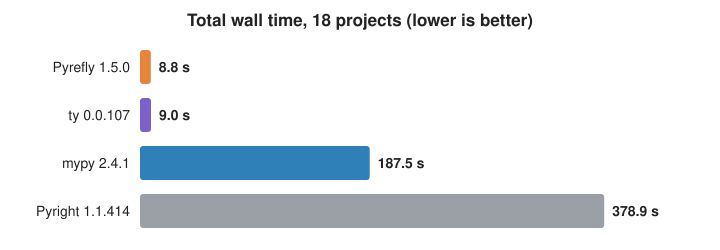

Pyrefly v1.5 is out. Highlights:

- **100% typing spec conformance**: Pyrefly passes all 146 test files in the typing conformance suite.
- **Faster checks**: 40% faster than v1.4.1 with 9% less memory, and faster than ty on some large projects, such as pytorch and sympy.
- **A new `hint` severity** makes IDE-only diagnostics, such as unused imports, configurable like any other error kind.
- **New checks, library support, and editor features**, including Pydantic validation, type source in hover, and class hierarchy CodeLens.

<!--truncate-->

This release includes 1,466 commits from 81 contributors. To get started, run:

```shell
pip install --upgrade pyrefly==1.5.0
```

For the full list of changes, see the [v1.5.0 release notes](https://github.com/pyrefly-org/pyrefly/releases/tag/1.5.0).

---

## 100% typing spec conformance

Pyrefly now passes all 146 test files in the [typing conformance suite](https://github.com/python/typing/tree/main/conformance), the reference tests for the Python typing specification. When type checkers follow the spec, annotations and stubs work the same way across tools.

Some conformance fixes change how names in annotations resolve: postponed annotations now look up names in the enclosing class body first. See the [release notes](https://github.com/pyrefly-org/pyrefly/releases/tag/1.5.0) for details.

---

## Faster checks

Pyrefly v1.5 is faster than v1.4.1 on all 71 projects in two public benchmark suites: Astral's [ty_benchmark](https://github.com/astral-sh/ruff/tree/main/scripts/ty_benchmark) and the [python-type-checking benchmark](https://python-type-checking.com/typecheck_benchmark/). Across these projects, the geometric mean of wall time is 0.60x of v1.4.1 (40% faster), CPU time is 0.65x, and memory is 0.91x.

Some of the largest improvements:

| Project | v1.4.1 | v1.5 | Speedup |
|---|---|---|---|
| pydantic | 2.29 s | 0.21 s | 11.0x |
| networkx | 12.25 s | 2.80 s | 4.4x |
| dask | 4.06 s | 0.94 s | 4.3x |
| ComfyUI | 3.77 s | 0.89 s | 4.2x |
| scipy | 14.20 s | 4.01 s | 3.5x |
| tensorflow | 4.79 s | 2.08 s | 2.3x |
| scikit-learn | 2.86 s | 1.73 s | 1.7x |
| numpy | 19.10 s | 12.89 s | 1.5x |

All measurements are cold `pyrefly check` runs with [hyperfine](https://github.com/sharkdp/hyperfine) on an M5 Max MacBook Pro with 18 threads.

These are the main changes:

- **Profile-guided optimization.** Release executables are built with PGO, and Linux x86-64 executables are also optimized with BOLT. On Linux x86-64, `pyrefly check` is about 20% faster on projects outside the training set, and a language server editing session is about 19% faster.
- **Less contention between threads.** A type now refers to its class through a small ID instead of a reference-counted pointer, so threads that check in parallel no longer contend on shared reference counts. This change alone cuts total CPU time by 24% and wall time by 10% on the 53 packages of the python-type-checking benchmark.
- **Abstract class construction.** Constructing an instance of an abstract class no longer infers the return type of every method in its class hierarchy. This inference could cascade through whole libraries, and removing it accounts for most of the speedup on networkx, dask, ComfyUI, and scipy.
- **Large TypedDict unions.** Pyrefly compares unions of TypedDicts more efficiently. pydantic's `CoreSchema` is a union of about 60 TypedDicts, which is why pydantic is 11 times faster.

### Comparison with ty, mypy, and Pyright

We also ran ty's own benchmark, which checks 18 projects, with Pyrefly v1.5, ty 0.0.107, mypy 2.4.1, and Pyright 1.1.414. Each tool uses the benchmark's configuration and its default concurrency (18 threads for Pyrefly and ty).



Pyrefly is faster than mypy and Pyright on all 18 projects: 13x faster than mypy and 25x faster than Pyright (geometric mean of wall time).

Pyrefly and ty are about even. Across all 18 projects, Pyrefly uses 0.86x the CPU time and 0.94x the memory of ty. Per project, wall time is mixed: Pyrefly is faster on some of the largest projects, such as pytorch and sympy, and ty is faster on most of the smaller ones, by a few milliseconds to tens of milliseconds. Closing that gap is a focus for upcoming releases.

The table below shows a selection of the projects:

| Project | Pyrefly | ty | mypy | Pyright |
|---|---|---|---|---|
| sympy | 592 ms | 923 ms | 5.8 s | 29.5 s |
| pytorch | 1.48 s | 2.02 s | 21.1 s | 83.4 s |
| sqlalchemy | 297 ms | 383 ms | 2.7 s | 9.4 s |
| django | 247 ms | 294 ms | 2.4 s | 7.1 s |
| discord.py | 118 ms | 135 ms | 1.9 s | 4.3 s |
| homeassistant | 2.53 s | 2.51 s | 49.7 s | 136.5 s |
| numpy | 997 ms | 827 ms | 69.4 s | 65.0 s |
| pandas | 819 ms | 563 ms | 9.1 s | 14.8 s |
| black | 99 ms | 83 ms | 977 ms | 1.9 s |
| **Total (18 projects)** | **8.8 s** | **9.0 s** | **187.5 s** | **378.9 s** |

On the largest projects, Pyrefly also uses less memory than the other checkers. On pytorch, Pyrefly uses 839 MB, ty 1.74 GB, mypy 1.80 GB, and Pyright 4.10 GB.

To reduce noise from background processes, Pyrefly and ty ran in alternating order, 15 measured runs per project, and runs that overlapped background activity were excluded. mypy and Pyright ran at least 3 times per project.

---

## A new `hint` severity

Some diagnostics used to be IDE-only: they appeared in your editor, but you could not configure or suppress them. In v1.5, they are regular error kinds at a new `hint` severity:

- `unused-import`
- `unused-parameter`
- `unused-variable`
- `unreachable`
- `inactive-code` (formerly `unreachable-code`)

By default, hints appear in your editor and are hidden from `pyrefly check` output. Because they are now error kinds, you can set their severity in your config, silence them with suppression comments, or promote them to errors:

```toml
[errors]
unused-import = "error"
```

`pyrefly check` now also prints warnings by default, such as uses of deprecated APIs and `redundant-cast`. Warnings don't affect the exit code. To hide them, set `min-severity = "error"`.

---

## Type checking

- **More precise narrowing** for `and` and `or` expressions, `type(x) is C` comparisons, and tuple elements guarded by `any(...)` or `all(...)`.
- **More accurate exhaustiveness checks** for `match` statements, especially on tuple subjects and class patterns.
- **More uninitialized-name checks**, such as a name assigned in a loop that may `break`.
- **Docstring types.** The opt-in `infer-param-types-from-docstring` option uses Sphinx `:param <type> <name>:` and `:type <name>:` fields for unannotated parameters, which helps with older libraries.
- **New checks:**
  - `unexpected-never` reports functions that can never return but aren't annotated `NoReturn` or `Never`.
  - `fallback-search-path-relative-import` reports imports that resolve only through a heuristic and may fail at runtime.
  - Opt-in `explicit-any-use` and `partially-unknown-type` show where `Any` and partially unknown types flow through your code.
  - Opt-in `protected-access` reports access to single-underscore members from outside their class.
  - Opt-in `invalid-format-spec` checks f-string format specifications.

---

## Library support

- **Pydantic**: `model_validate` and `model_construct` calls are type checked, and constructor checks follow lax-mode coercion more closely, which removes false positives for enums, named tuples, and `NewType`s.
- **Django**: model fields and managers have more accurate types, including fields accessed on the class, custom `id` primary keys, and `Manager.as_manager()` querysets.
- **SQLAlchemy**: `select().filter_by()` checks field names and value types.
- **FastAPI**: completion and go-to-definition work for endpoints called through `TestClient`.

---

## Language server

- **Type source in hover** shows where a type was narrowed or first inferred.
- **Parameter documentation** from `Annotated[..., Doc()]` and numpydoc docstrings appears in hover and signature help.
- **Class hierarchy CodeLens** shows overrides and implementations.
- **Better completions**: recently used items come first, deprecated items come last, and auto-imports use common aliases such as `import numpy as np`.
- **New quick fixes** insert an inferred type annotation, or stubs for a class's unimplemented abstract members.
- **Quoted annotations** support go-to-definition, find references, and rename.
- **Inlay hints** show parameter names at call sites.

---

## Configuration and CLI

- **`pyrefly check <dir>` honors config excludes**, so `pyrefly check .` checks the same files as `pyrefly check`.
- **PEP 723 scripts** can be checked in their own uv environments with `script-command`, or skipped with `--exclude-scripts`.
- **Pixi** default environments are discovered automatically.
- **New options**: `only` in config files, `--extend-project-excludes`, `--force-exclude`, and `dump-config --full`.

---

## Tensor shapes

- **Broader stub coverage** for NumPy, PyTorch, and JAX, including NumPy random generators and linear algebra, `jax.jit`, and `Array.at` indexing.
- **Einops** shape inference works with JAX and NumPy.
- **Shape stubs** are discovered through `{package}-shape-stubs` packages.

Tensor shape support remains experimental. See the [tensor shapes documentation](https://pyrefly.org/en/docs/tensor-shapes/) for current APIs and examples.

---

## Upgrading

Some changes in this release can surface new errors, most notably the annotation scoping changes and warnings in `pyrefly check` output. The [release notes](https://github.com/pyrefly-org/pyrefly/releases/tag/1.5.0) list the behavior changes and explain how to suppress new errors while you upgrade.

---

## Thank you

We closed 123 bug issues in this release. Many of them started as a report with a small reproduction from the community. If Pyrefly reports an error on code that you think is correct, or anything else looks wrong, please [open an issue](https://github.com/pyrefly-org/pyrefly/issues).

Thank you to the 81 contributors to v1.5, and to everyone who has filed a bug report.

- [GitHub milestones](https://github.com/pyrefly-org/pyrefly/milestones): upcoming releases
- [Discord](https://discord.gg/Cf7mFQtW7W): chat with the team
